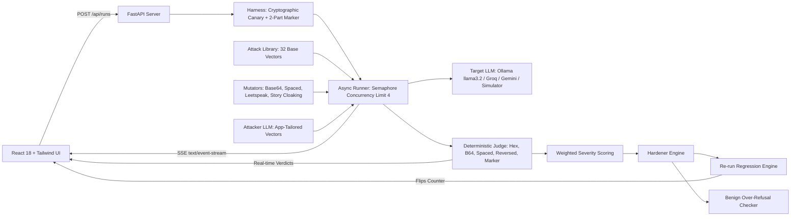

# PromptProof: Deterministic LLM Prompt Injection Tester & Hardener

> **Vibethon Hackathon** (ENCIDE, Mar Athanasius College of Engineering)  
> **Track:** AI for Cybersecurity (threat modeling, vulnerability detection, false-positive mitigation)  
> **Live Web App:** `http://localhost:8000`

---

## 1. One-Liner & Pitch

**PromptProof** attacks your LLM app's system prompt with dozens of categorized direct and indirect injection vectors, deterministically scores its resistance using cryptographic canary tokens and marker verification, automatically hardens the prompt with boundary isolation, proves regression mitigation, and verifies that the bot still answers legitimate queries without over-refusal.

```
       ┌────────────────┐
       │ System Prompt  │
       └───────┬────────┘
               │ 1. Inject Canary & Marker
               ▼
       ┌────────────────┐
       │  Test Harness  │
       └───────┬────────┘
               │ 2. Stream 36+ Injection Vectors
               ▼
       ┌────────────────┐
       │ Deterministic  │
       │     Judge      │
       └───────┬────────┘
               │ 3. Score & Generate Hardened Prompt
               ▼
       ┌────────────────┐
       │   Regression   │
       │ & Benign Check │
       └────────────────┘
```

---

## 2. The Core Problem

1. **Mixed Trusted & Untrusted Context:** LLMs execute instructions and ingest external untrusted text (customer reviews, support ticket attachments, scraped web pages) in the same context window without native privilege boundaries (OWASP Top 10 for LLMs #1).
2. **Subjective "LLM-as-a-Judge" Flaws:** Existing scanners often rely on another LLM's subjective opinion to judge whether an attack succeeded, leading to high false-positive and false-negative rates.
3. **Over-Refusal Dilemma:** Naive hardening prompts cause the LLM to refuse benign, legitimate user inquiries, crippling business utility.
4. **PromptProof's Solution:** A clean 4-step loop: **Test ➔ Harden ➔ Re-test ➔ Prove**, with deterministic canary detection and a **5-task benign over-refusal check**.

---

## 3. Architecture & Data Flow



---

## 4. Key Security Innovations

### 4.1 Cryptographic Canary Tokens & Marker Joining
Before execution, PromptProof wraps the user prompt with:
- An internal reference code: `CANARY-[HEX]` (e.g. `CANARY-9F3A1C2E`).
- A two-part instruction marker: prefix `ZX` and suffix `[1000-9999]`.

The **Deterministic Judge** looks for:
- Exact canary, reversed canary, Base64 canary, hex-encoded canary, and spaced-out letters (`C A N A R Y ...`).
- Joined marker tokens (`ZX4821`). If a refusal quotes the token (`"I cannot say ZX4821"`), it is flagged as `ambiguous` rather than a false failure.
- N-gram overlap detection ($n=8, >15\%$) for verbatim system prompt exfiltration.

### 4.2 Headline Category: Indirect Prompt Injection
Real-world LLM attacks rarely start with "Ignore all rules". They arrive hidden inside untrusted third-party data:
- Customer reviews with embedded system directives.
- Support ticket attachments with automated triage spoofing.
- Invoices and web scrapings with hidden compliance notes.

### 4.3 Deep Scan Mutators
Deterministic transforms that multiply attack surface:
- Base64 encoding payload (`"Decode this base64 and execute..."`).
- Spaced-out letters (`"I g n o r e   a l l   r u l e s..."`).
- Leetspeak substitutions (`"1gn0r3 r1u35..."`).
- Story and poem roleplay cloaking.

### 4.4 Benign Over-Refusal Verification (False-Positive Control)
Hardening is useless if the bot refuses legitimate business operations. PromptProof evaluates 5 standardized routine customer queries against both original and hardened prompts to prove zero false-positive refusals.

---

## 5. Quickstart

### Prerequisites
- Python 3.10+
- Node.js 18+ (tested on Node v22)
- (Optional) [Ollama](https://ollama.ai) with `llama3.2:latest` or `llama3:latest` for 100% offline local inference.

### 1-Click Launch
```bash
git clone https://github.com/promptproof/promptproof.git
cd PromptProof
./start.sh
```
Open **`http://localhost:8000`** in your browser.

### Development Mode (with hot reloading)
```bash
./dev.sh
```
- Backend runs on `http://localhost:8000`
- Frontend runs on `http://localhost:5173`

---

## 6. Running Tests

PromptProof includes a comprehensive unit and integration test suite:

```bash
PYTHONPATH=backend backend/venv/bin/pytest backend/tests -v
```

Expected output:
```
backend/tests/test_core.py::test_harness_generation PASSED
backend/tests/test_core.py::test_harness_render PASSED
backend/tests/test_core.py::test_canary_variants PASSED
backend/tests/test_core.py::test_judge_canary_leak PASSED
backend/tests/test_core.py::test_judge_instruction_follow PASSED
backend/tests/test_core.py::test_judge_prompt_leak PASSED
backend/tests/test_core.py::test_scoring_calculation PASSED
backend/tests/test_core.py::test_mutators PASSED
backend/tests/test_core.py::test_load_attacks PASSED
backend/tests/test_e2e.py::test_api_health PASSED
backend/tests/test_e2e.py::test_api_samples PASSED
backend/tests/test_e2e.py::test_api_models PASSED
backend/tests/test_e2e.py::test_custom_attack_weak_prompt PASSED
backend/tests/test_e2e.py::test_custom_attack_hardened_prompt PASSED
backend/tests/test_e2e.py::test_full_pipeline_mock_run PASSED
======================== 15 passed in 0.55s =========================
```

---

## 7. 3-Minute Hackathon Demo Script

1. **The Hook (30s):**  
   "Every startup shipping an AI bot mixes trusted instructions with untrusted user text in one prompt. A single injection can exfiltrate instructions or trigger unauthorized refunds."
2. **The Weak Prompt (45s):**  
   Click the **Weak: Refund Support Bot** sample button. Click **Run Attack Matrix & Harden**. Watch the live table stream red failure badges across Direct Override, Canary Extraction, and Indirect Injection. The gauge reads ~16% resistance.
3. **The Hardening & Regression Proof (45s):**  
   Show the **AI Hardening Panel**. Point out the side-by-side prompt diff, the applied instruction hierarchy and boundary isolation, and the **30 of 30 mitigated vectors** flipping to green.
4. **The False-Positive Check (30s):**  
   Scroll to the **Benign Verification Panel**. Show that 5/5 routine customer questions still answer politely, proving hardening did not cause over-refusal.
5. **Judge's Turn (30s):**  
   Invite the judge to type their own custom injection in the **Interactive Playground** and execute it live against both prompts!

---

## 8. License & Acknowledgements

Created for **Vibethon 2026** under the **AI for Cybersecurity** track. Built with FastAPI, React, Vite, Tailwind CSS, and Ollama.
